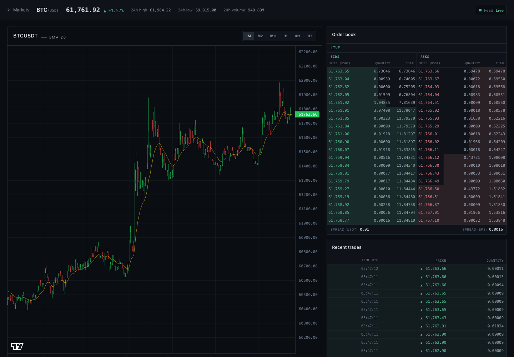
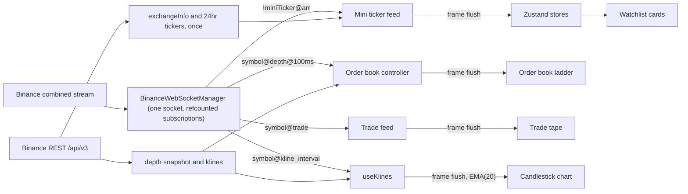
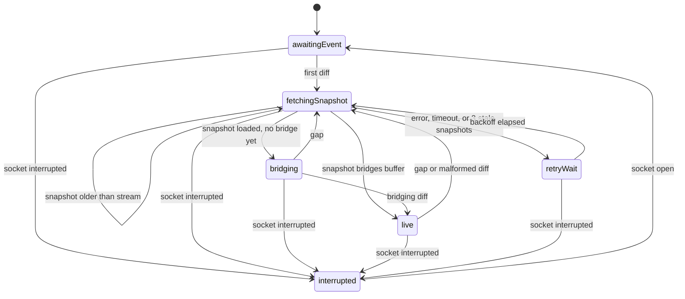

# Depth View

Depth View is a real-time spot market terminal for Binance USDT pairs. It shows
a live watchlist, and for each pair a candlestick chart with an EMA(20) overlay,
a 20-level order book on each side, and a trade tape.

It runs entirely in the browser. There is no backend: the app calls Binance's
public REST and WebSocket market data endpoints directly.



## Features

- **Watchlist.** Twenty USDT spot pairs with last price, 24h change, quote
  volume and a sparkline of recent closes. Prices come from the all-market
  `!miniTicker@arr` stream, filtered to the selected pairs, and one 24h REST
  snapshot seeds the grid.
- **Symbol page.** Candlestick chart with 1m, 5m, 15m, 1h, 4h and 1d timeframes
  and an EMA(20) line. The page redirects to the watchlist for unknown symbols.
- **Order book.** Top 20 bids and asks, each row with a cumulative depth bar.
  The header shows the spread in quote units and in basis points.
- **Trade tape.** The most recent 50 trades for the symbol, newest first.
- **Connection details.** A feed status badge opens a popover with messages per
  second, last message time and age, sequence gaps, reconnect attempt and the
  countdown to the next reconnect.
- **Performance overlay.** Press Shift+P to toggle a small readout with FPS,
  WebSocket messages per second, book gap count and profiler commits per second.
  Profiler commits are only sampled in development builds.
- **About page.** Describes the app, its stack and the technical decisions below.

## Stack

- **React 19** for components, with the React Compiler applied through the
  Vite Babel plugin.
- **TypeScript** for typed wire payloads, models and view state.
- **Vite** for the dev server and production build.
- **Tailwind CSS v4** (via `@tailwindcss/vite`) for utility styling alongside
  plain component stylesheets.
- **XState v5** for the order book sync phases, as an explicit state machine.
- **Zustand** for shared stores (tickers, exchange info, market health), read
  through narrow selectors.
- **TanStack Router** for typed routes, including the `$symbol` parameter.
- **lightweight-charts** for canvas candlestick and line rendering, wrapped by a
  small chart adapter.
- **oxlint and oxfmt** for linting and formatting.
- **Vitest** with Testing Library and jsdom for unit and component tests.

## Architecture

The data flow is one shared WebSocket, a set of stream-specific handlers, and
frame-batched writes into stores and component state.



### Exact decimals

Prices and quantities are never parsed as JavaScript numbers on the financial
path. They stay decimal strings from the wire to the rendered text.

- `src/lib/decimal.ts` accepts only `-?\d+(\.\d+)?` (no exponents, signs other
  than a leading minus, or whitespace). Each value is turned into a `bigint`
  plus a scale (its fraction length).
- `add`, `subtract` and `compare` align both operands to the larger scale.
  `multiply` adds the scales. `formatDecimal` strips trailing fraction zeros.
- `decimalRatio` divides as `bigint` and truncates to a requested number of
  digits. The order book spread in basis points uses 18 digits.
- On ingest, every level in a depth event and snapshot is normalized
  (`'1.10'` becomes `'1.1'`), so equal prices compare equal as strings. A
  quantity of `'0'` removes the level.
- The EMA is exact too. The seed is the mean of the first 20 closes, and each
  later value is `(previous * 19 + close * 2) / 21`, truncated at 12 fraction
  digits. The result is a deterministic function of the input strings.

Numbers leave the decimal domain only at display or rendering boundaries:
the depth bar fraction (computed exactly, then converted with `Number`), the
sparkline geometry, the 24h percent display value, and the chart adapter's
conversion to lightweight-charts coordinates.

### Order book synchronization

`src/lib/orderbook/` implements the snapshot and diff procedure used by
Binance's diff-depth stream.

The sync phase is an XState machine (`syncMachine.ts`). The controller
(`controller.ts`) owns the book data, the pre-snapshot buffer and view
publication, and forwards socket events to the machine. The machine owns the
snapshot request (cancelled and aborted when its phase exits), the request
timeout and the retry backoff. Book operations report results such as `gap`
or `stale-snapshot` back to the machine as events.



The view state is derived from the phase: `live` shows the book; any other
phase shows the last good view as `stale`, or `connecting` (waiting,
interrupted), `syncing` (snapshot, bridging) or `error` (retry) before the
first live view.

- The controller subscribes to `symbol@depth@100ms` and buffers diff events,
  up to 5,000. A full buffer forces a resync.
- The `GET /api/v3/depth` snapshot (limit 1000) is requested only after the
  first diff event arrives, so the snapshot is not older than the stream it
  has to bridge. The same rule applies after a reconnect.
- If a snapshot is still older than the first buffered event
  (`U > lastUpdateId + 1`), it is fetched again without counting a gap. Three
  consecutive stale snapshots fall back to the normal retry path.
- When the snapshot arrives, buffered events with `u` at or below the snapshot's
  `lastUpdateId` are discarded. The first remaining event must bracket
  `lastUpdateId + 1` (`U <= lastUpdateId + 1 <= u`). Every later event must
  have `U` equal to the previous `u + 1`. Any violation is a gap.
- In the live state, an event with `u` at or below the last applied id is
  ignored as a duplicate or stale event. An event whose `U` does not equal the
  last applied id plus one, or whose `u` is below its `U`, is a gap. A
  malformed event in the live state is also treated as a gap.
- A gap increments the gap counter and starts a new snapshot. Late or
  out-of-order events are treated the same way, because the next expected id
  no longer lines up.
- A failed or timed-out snapshot (10 s timeout) is retried automatically with
  exponential backoff from 250 ms, capped at 5 s. While this happens, the view
  shows `error`, or `stale` when a last good view exists. The retry counter
  resets only after the book is live again.
- Any connection interruption (closing, closed, disconnected or reconnecting)
  invalidates the sync, clears the local book, and keeps the last good view
  marked `stale`. A reopened socket always takes a new snapshot.
- The local book keeps up to 1,000 levels per side. The view exposes the top
  20 per side with cumulative quantities. Views reuse unchanged row objects and
  return the previous view when nothing visible has changed.
- `orderBookRegistry` reference-counts controllers per symbol. The first
  consumer starts the controller and the last release stops it and clears its
  state.

### Event ordering and replays

- **Order book:** duplicate and stale diffs are dropped by update id. Out-of-
  order delivery becomes a gap and a resync, not a reorder.
- **Mini ticker:** frames are keyed by symbol and only the latest buffered frame
  is kept. A frame whose event time `E` is older than the buffered one is
  dropped. Symbols outside the selected pair set are ignored.
- **Trade tape:** trade ids are strictly increasing per symbol. Any id at or
  below the highest seen is rejected, which filters replayed trades after a
  reconnect. Pending trades are de-duplicated by id and the list keeps the
  newest 50 rows.
- **Klines:** a live candle with the same open time as the last retained bar
  replaces it. An older bar is ignored. A bar that skips more than one interval
  triggers a full REST refetch.

### Render coalescing

- `src/lib/frameTask.ts` provides one flush per frame. `request()` schedules a
  `requestAnimationFrame` callback and a 250 ms timer. Whichever fires first
  runs the flush and cancels the other, so updates still flush when animation
  frames are not delivered. Repeated requests before a flush collapse into one
  call.
- The mini ticker feed, the order book publisher, the trade feed and the kline
  hook all write through this primitive. Socket handlers only buffer.
- Components subscribe to the smallest slice they render. `TickerCard` is
  memoized and reads only its own symbol's entry. `useOrderBook(symbol, selector)`
  is a `useSyncExternalStore` hook with a per-registration selector cache.
  `useTrades` returns the same array when the list is unchanged.

### WebSocket lifecycle

`src/lib/binance/BinanceWebSocket.ts` owns one `WebSocket` for the whole app,
connected to the combined-stream endpoint `wss://stream.binance.com:9443/stream`.

- **Single connection, refcounted streams.** The first handler for a stream name
  sends `SUBSCRIBE`. The last removal sends `UNSUBSCRIBE`. Registering the same
  handler twice still delivers one call per message.
- **Reconnect with backoff.** A close or error schedules a reconnect at 1 s,
  then 2 s, 4 s and so on, capped at 30 s. The counter resets when the socket
  opens. On open, every active stream is resubscribed in one `SUBSCRIBE`.
- **Watchdog.** A 30 s timer covers the handshake and is re-armed by every
  inbound frame. If it fires, the socket is closed with code 4000 and the
  reconnect flow runs once, without a second one from the close event.
- **Generation guard.** Each socket carries a generation number, so late events
  from a replaced or abandoned socket are ignored.
- **Server pings.** A `{ping}` message is answered with `{pong}`.
- **Tab visibility.** A hidden tab closes the socket and stays closed. A visible
  tab reconnects only if the visibility pause caused the close. An intentional
  disconnect is never undone by visibility changes.
- **Metrics.** Message timestamps are kept in a 1 s sliding window of up to
  2,048 entries, which yields `messagesPerSecond`. The manager also exposes
  `lastMessageAt`, `reconnectAttempt` and `nextReconnectAt`. Status changes are
  published to the health store and to subscribers such as the order book and
  kline hook.

### Chart data and bounded history

- `useKlines` keeps at most 500 candles. The REST fetch asks for 500, and the
  pending live buffer is capped at 500 keyed by open time.
- The EMA(20) is recomputed over the retained window on each publish. Its seed
  is the mean of the first 20 retained closes, so early EMA values depend on
  where the window starts.
- A series is accepted only if every adjacent bar is exactly one interval
  apart. Otherwise the hook shows an error and offers retry.
- On reconnect, the hook refetches the full 500-candle history, merges any
  buffered live candles into it, and keeps the existing chart visible with a
  `resyncing` status during the fetch.
- Live updates reach the chart through `series.update` for the changed bars.
  Full replacements call `setData` and fit the time scale.

## Running locally

Requires [pnpm](https://pnpm.io/). The repository includes `pnpm-lock.yaml`.

```bash
pnpm install
pnpm dev            # Vite dev server
pnpm build          # tsc -b, then vite build
pnpm preview        # serve the production build
pnpm lint           # oxlint over src
pnpm format         # oxfmt over src (writes)
pnpm format:check   # oxfmt over src, no writes
pnpm test           # vitest run
```

No environment variables are needed. The app calls `https://api.binance.com`
for REST and `wss://stream.binance.com:9443/stream` for WebSocket data, both
from the browser.

## Testing

`pnpm test` runs the Vitest suite. Test files sit next to the modules they cover,
and the suite spans these areas:

- Exact decimal arithmetic and normalization, the frame task scheduler, and
  the EMA(20) computation.
- Order book logic: the pure book operations, the sync controller, its hook,
  and the order book component.
- The WebSocket manager, the stream payload guards, the REST client, and the
  mini ticker transformer.
- Ticker state: the mini ticker and 24h snapshot bootstrap, the exchange info
  hook, the market stats and WebSocket status hooks, and the market health
  store.
- Klines: parsing and history handling, the `useKlines` hook, and the chart
  adapter.
- Trades: the trade feed, the `useTrades` hook, and the trade tape component.
- Components and pages: ticker cards, the connection details popover, the
  performance overlay, and the symbol page.

## License

[MIT](LICENSE)
